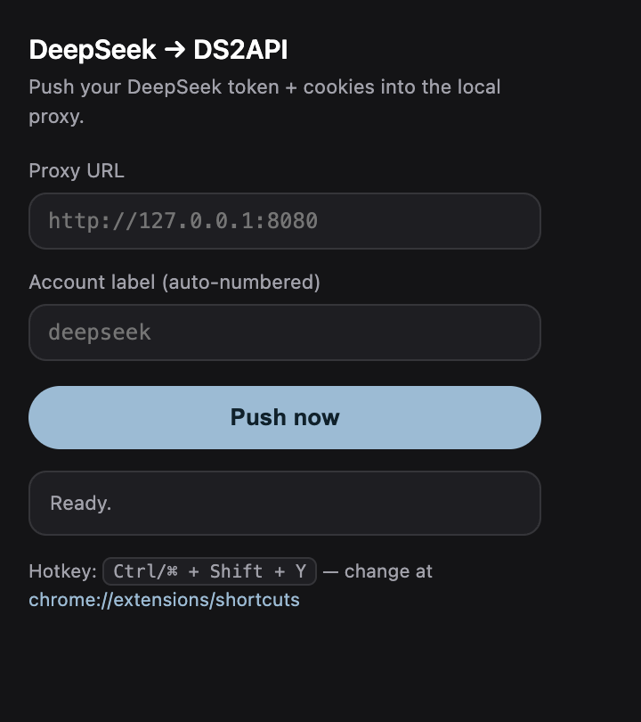
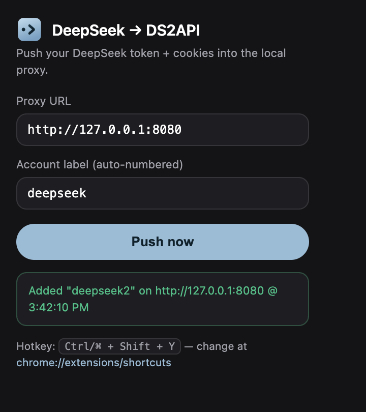

# DeepSeek Chat → OpenAI-compatible proxy (minimal)

Turns the free **chat.deepseek.com** web backend into an **OpenAI-compatible
`/v1/chat/completions`** endpoint, served out of a pool of your DeepSeek session
tokens. No official API key needed — it solves the site's PoW challenge itself.

> This is a stripped-down English fork of the
> [original project](https://github.com/snake-aabb-wtf/deepseek-web2api-free),
> pared back to the essentials: the **account pool**, a **Playground**, **DeepSeek
> session-token import**, an **Overview** panel, and an **env-vars** view on the
> Settings screen. The admin login is removed (it runs on localhost).

## Panels (`http://127.0.0.1:8080/webui/`)

- **Overview** — live request stats (total / success / latency / tokens), trend
  charts, and account-pool status.
- **Account Pool** — add / edit / delete / re-login DeepSeek accounts; round-robin
  across them per request.
- **Playground** — test chat (quick / expert, with the reasoning stream shown).
- **Settings** — read-only view of the effective runtime configuration.

## Quick start

```bash
# 1. Python deps (Python 3.10–3.13)
python3 -m venv .venv && .venv/bin/pip install -r requirements.txt

# 2. Build the WebUI
cd webui-new && npm install && npm run build && cd ..

# 3. Config (optional — sensible defaults)
cp .env.example .env

# 4. Run
.venv/bin/python -m uvicorn server:app --host 127.0.0.1 --port 8080
```

Then open `http://127.0.0.1:8080/webui/`. Point any OpenAI client at base URL
`http://127.0.0.1:8080/v1` (no key needed locally). Models: `deepseek-chat`
(quick) and `deepseek-reasoner` (expert).

## Importing a DeepSeek session token

Two ways to get a logged-in DeepSeek session into the pool:

1. **WebUI** — Account Pool → Add. On chat.deepseek.com (logged in): F12 →
   Network → send a message → copy the `Authorization` Bearer token and the full
   `Cookie` header into the form.
2. **Chrome extension** ([`chrome-extension/`](chrome-extension/)) — press a
   hotkey while logged in and it pushes your token + cookies (including HttpOnly
   ones like `cf_clearance`) straight into the pool, auto-numbering each push
   (`deepseek`, `deepseek2`, …). See its [README](chrome-extension/README.md).

<p align="center">
  
  &nbsp;
  
</p>

## Run as a service (macOS)

`deploy/` has a launchd LaunchAgent that starts the proxy at login and keeps it
alive — see [deploy/README.md](deploy/README.md).

## License

Released into the public domain under the **Unlicense**. For research/learning
only; unofficial and not affiliated with DeepSeek.
